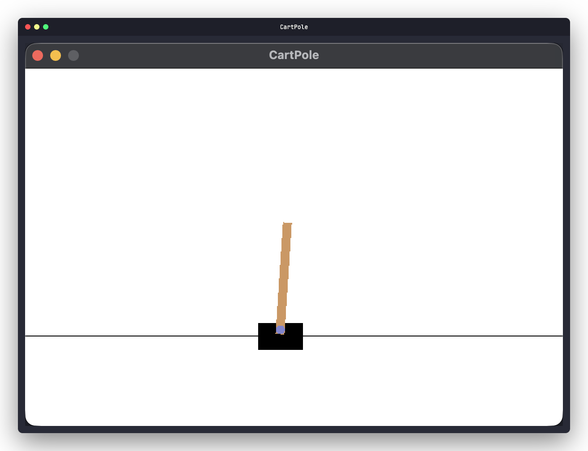
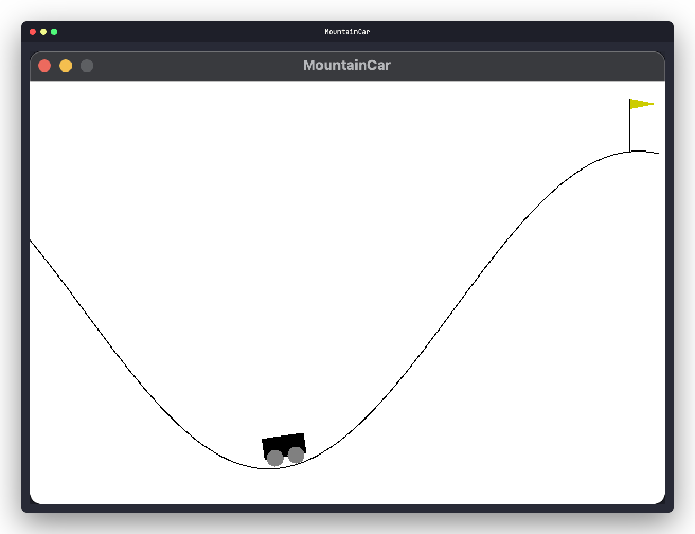

<p align="center">
  <h1 align="center">gymnasia</h1>
  <p align="center">
    OpenAI Gymnasium environments in pure Rust.
    <br /><br />
    <a href="#installation">Install</a>
    &middot;
    <a href="https://github.com/urmzd/gymnasia/issues">Report Bug</a>
    &middot;
    <a href="https://crates.io/crates/gymnasia">Crates.io</a>
  </p>
</p>

<p align="center">
  <a href="https://github.com/urmzd/gymnasia/actions/workflows/ci.yml"></a>
  &nbsp;
  <a href="https://crates.io/crates/gymnasia"></a>
  &nbsp;
  <a href="LICENSE"></a>
</p>

<p align="center">
   &nbsp;  &nbsp; 
</p>
<p align="center"><em>CartPole &middot; MountainCar &middot; CartPole (headless)</em></p>

## Contents

- [Features](#features)
- [Installation](#installation)
- [Quick Start](#quick-start)
- [Examples](#examples)
- [Usage](#usage)
- [Configuration](#configuration)
- [API](#api)
- [Development](#development)
- [Documentation](#documentation)
- [Agent Skill](#agent-skill)
- [License](#license)

## Features

- **Pure Rust**: no C bindings, no SDL2, no system libraries to install.
- **Headless by default**: simulation compiles with zero graphics dependencies; rendering is opt-in behind the `render` feature.
- **Classic control environments**: CartPole and MountainCar.
- **13 composable wrappers**: time limits, autoreset, reward and observation normalization, action clipping and rescaling, custom transforms.
- **Typed wrapper data**: wrappers expose metadata through methods such as `episode_return()` and `steps_remaining()`, not an info dict.
- **Generic spaces**: `BoxSpace<B: Bounded>` works with your own observation types.
- **Opt-in flattening**: `Flatten` converts observations to and from `Vec<f64>` for ML pipelines.

## Installation

### Prerequisites

| Requirement | Version |
|-------------|---------|
| [Rust](https://rustup.rs/) | 1.82.0+ (2021 edition) |

Add the crate (headless):

```bash
cargo add gymnasia
```

Add it with window rendering:

```bash
cargo add gymnasia --features render
```

## Quick Start

```bash
cargo add gymnasia
```

<!-- fsrc src="examples/cartpole_headless.rs" fence="auto" -->
```rust
use gymnasia::{core::Env, envs::classical_control::cartpole::CartPoleEnv};
use rand::{thread_rng, Rng};

/// Runs cartpole training in headless mode (no rendering).
///
/// This example works without the `render` feature, demonstrating
/// that the core simulation has zero graphics dependencies.
fn main() {
    let mut env = CartPoleEnv::new();
    env.reset(None, None);

    const N: usize = 15;
    let mut rewards = Vec::with_capacity(N);

    let mut rng = thread_rng();
    for _ in 0..N {
        let mut current_reward = 0.0_f64;

        for _ in 0..475 {
            let action: i64 = rng.gen_range(0..=1);
            let state_reward = env.step(action);
            current_reward += state_reward.reward;

            if state_reward.terminated {
                break;
            }
        }

        env.reset(None, None);
        rewards.push(current_reward);
    }

    println!("{:?}", rewards);
}
```
<!-- /fsrc -->

```bash
cargo run --example=cartpole_headless --no-default-features
```

See [`examples/`](examples/) for more.

## Examples

| Example | Description |
|---------|-------------|
| [`cartpole_headless`](examples/cartpole_headless.rs) | Random-action CartPole episodes with no graphics dependencies |
| [`cartpole`](examples/cartpole.rs) | CartPole in a window (requires `render`) |
| [`mountain_car`](examples/mountain_car.rs) | MountainCar in a window (requires `render`) |

```bash
cargo run --example=cartpole --features render
cargo run --example=mountain_car --features render
```

## Usage

### Stack wrappers

Wrap an environment to compose behaviors. Read wrapper data through typed methods:

```rust
use gymnasia::core::Env;
use gymnasia::envs::classical_control::cartpole::CartPoleEnv;
use gymnasia::wrappers::{TimeLimit, RecordEpisodeStatistics};

let env = CartPoleEnv::new();
let env = TimeLimit::new(env, 500);
let mut env = RecordEpisodeStatistics::new(env);
// Type: RecordEpisodeStatistics<TimeLimit<CartPoleEnv>>

let obs = env.reset(None, None);
let result = env.step(1);

println!("return: {}", env.episode_return());
println!("steps left: {}", env.inner().steps_remaining());
```

### Flatten observations for ML

```rust
use gymnasia::core::{Env, Flatten};
use gymnasia::envs::classical_control::cartpole::CartPoleEnv;

let mut env = CartPoleEnv::new();
let obs = env.reset(None, None);
let flat: Vec<f64> = obs.flatten();   // [x, x_dot, theta, theta_dot]
assert_eq!(flat.len(), 4);
```

### Render

Enable the `render` feature and wrap the environment in `RenderEnv`, which also implements `Env`:

```rust
use gymnasia::core::Env;
use gymnasia::render::{RenderEnv, renderer::RenderMode};
use gymnasia::envs::classical_control::cartpole::CartPoleEnv;

#[macroquad::main("CartPole")]
async fn main() {
    let env = CartPoleEnv::new();
    let mut renv = RenderEnv::new(env, RenderMode::Human);
    renv.reset(None, None);
    loop {
        let result = renv.step(1);
        renv.next_frame().await;
        if result.terminated { break; }
    }
}
```

To make your own environment renderable, implement `Renderable` and return a `DrawList` of backend-agnostic draw commands.

### Write a custom environment

Implement `Bounded` on your observation type so it works with `BoxSpace`, then implement `Env`. `Env` has no supertraits, so environments holding closures work.

```rust
use gymnasia::core::{Env, StepResult};
use gymnasia::spaces::{Bounded, BoxSpace, Discrete};

#[derive(Clone, Debug)]
struct MyObs { x: f64, y: f64 }

impl Bounded for MyObs {
    fn in_bounds(v: &Self, lo: &Self, hi: &Self) -> bool {
        v.x >= lo.x && v.x <= hi.x && v.y >= lo.y && v.y <= hi.y
    }
    fn sample_uniform<R: rand::Rng>(rng: &mut R, lo: &Self, hi: &Self) -> Self {
        MyObs { x: rng.gen_range(lo.x..=hi.x), y: rng.gen_range(lo.y..=hi.y) }
    }
    fn clamp(v: Self, lo: &Self, hi: &Self) -> Self {
        MyObs { x: v.x.clamp(lo.x, hi.x), y: v.y.clamp(lo.y, hi.y) }
    }
}

struct MyEnv { /* ... */ }

impl Env for MyEnv {
    type Action = i64;
    type Observation = MyObs;
    type ActionSpace = Discrete;
    type ObservationSpace = BoxSpace<MyObs>;
    type ResetOptions = ();

    fn step(&mut self, _: i64) -> StepResult<MyObs> { todo!() }
    fn reset(&mut self, _: Option<u64>, _: ()) -> MyObs { todo!() }
    fn action_space(&self) -> &Discrete { todo!() }
    fn observation_space(&self) -> &BoxSpace<MyObs> { todo!() }
}
```

### Migrate from v2

See [CHANGELOG.md](CHANGELOG.md) for the full list. Key changes:

| v2 | v3 |
|----|-----|
| `ActionReward<T, E>` | `StepResult<O>` |
| `reward: O64` | `reward: f64` |
| `info: Option<E>` | removed (wrappers own their data) |
| `reset(seed, return_info, options)` | `reset(seed, options)` returns `Observation` |
| `BoxR<T>` | `BoxSpace<B: Bounded>` |
| `Observation: Into<Vec<f64>>` required | `Flatten` trait (opt-in) |
| `Clone + Debug + Serialize` on `Env` | no supertraits |
| `Discrete(usize)` | `Discrete { n, start }` with `i64` element |
| `DiscreteRange` | merged into `Discrete::with_start()` |
| `RenderEnv` doesn't impl `Env` | `RenderEnv` implements `Env` |
| No wrappers | 13 composable wrappers |
| `use gymnasia::utils::renderer::RenderMode` | `use gymnasia::render::renderer::RenderMode` |

## Configuration

| Feature | Default | Description |
|---------|---------|-------------|
| `render` | No | macroquad-based window rendering and pixel capture |

## API

Full API documentation is on [docs.rs](https://docs.rs/gymnasia).

### Wrappers

Each wrapper is a generic struct that implements `Env` by delegating to an inner environment.

| Wrapper | Category | What it does |
|---------|----------|-------------|
| `TimeLimit` | Common | Truncates after N steps |
| `OrderEnforcing` | Common | Panics if `step()` before `reset()` |
| `Autoreset` | Common | Auto-resets on termination |
| `RecordEpisodeStatistics` | Common | Tracks cumulative reward and episode length |
| `ClipReward` | Reward | Clamps reward to `[min, max]` |
| `NormalizeReward` | Reward | Running mean/variance normalization |
| `TransformReward` | Reward | Apply custom `Fn(f64) -> f64` |
| `ClipAction` | Action | Clamps to action space bounds |
| `RescaleAction` | Action | Affine rescaling of `f64` actions |
| `TransformAction` | Action | Apply custom function, may change type |
| `FlattenObservation` | Observation | Flattens via `Flatten` trait to `Vec<f64>` |
| `NormalizeObservation` | Observation | Running mean/variance normalization |
| `TransformObservation` | Observation | Apply custom function, may change type |

### Spaces

| Space | Element | Description |
|-------|---------|-------------|
| `BoxSpace<B: Bounded>` | `B` | Continuous bounded space, generic over bounds type |
| `Discrete` | `i64` | `{start, ..., start+n-1}`, supports action masking |
| `MultiDiscrete` | `Vec<i64>` | Cartesian product of discrete spaces |
| `MultiBinary` | `Vec<u8>` | `{0, 1}^n` |

`Bounded` ships for `f64`, `f32`, and `Tensor` (flat `Vec<f64>` with shape metadata for high-dimensional spaces like images). `StepResult` reports reward as `f64`.

## Development

```bash
just fetch     # fetch dependencies
just build     # build the project
just fmt       # format code
just lint      # run clippy
just check     # run all CI checks (fmt + lint + test)
```

### Benchmarks

<!-- fsrc src="benches/RESULTS.md" -->
| Benchmark | Time (median) |
|-----------|---------------|
| `cartpole/step` | ~26 ns |
| `cartpole/reset` | ~21 ns |
| `cartpole/episode` | ~248 ns |
| `mountain_car/step` | ~25 ns |
| `mountain_car/reset` | ~15 ns |
| `mountain_car/episode` | ~4.6 µs |

> Apple M3 Pro, `cargo bench` via [Criterion](https://github.com/bheisler/criterion.rs). Run `cargo bench` to reproduce.
<!-- /fsrc -->

## Documentation

- [Usage guide](docs/usage.md)
- [Gymnasium compliance](docs/compliance.md)
- [Roadmap](docs/roadmap.md)
- [Changelog](CHANGELOG.md)
- [Contributing](CONTRIBUTING.md)

## Agent Skill

This repo's conventions are available as portable agent skills in [`skills/`](skills/).

## License

Licensed under [Apache 2.0](LICENSE). Forked from [MathisWellmann/gym-rs](https://github.com/MathisWellmann/gym-rs).
